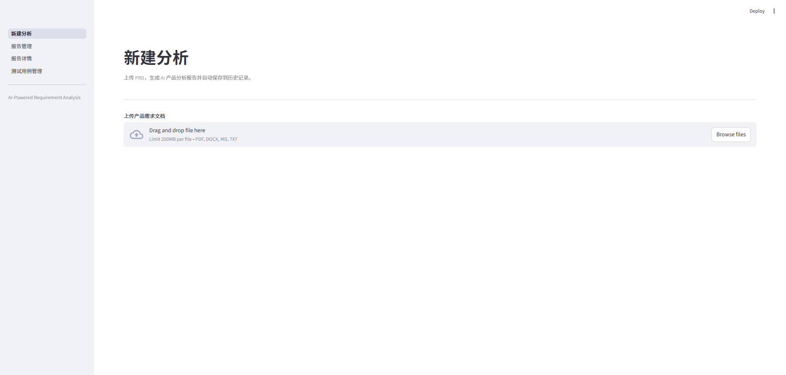
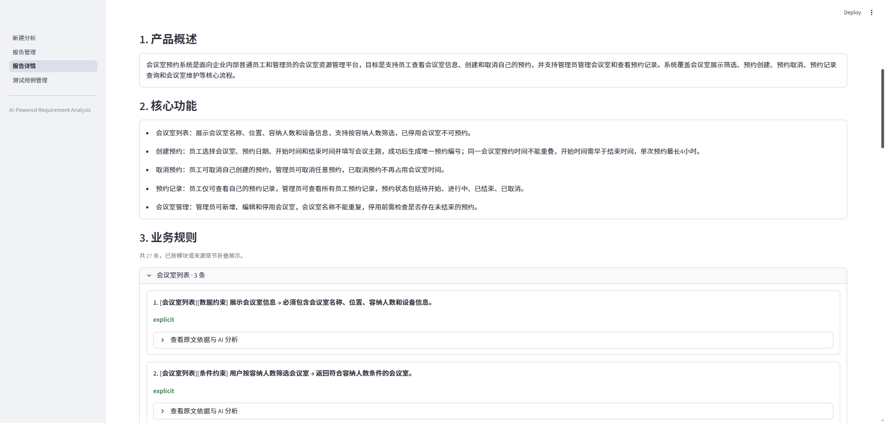
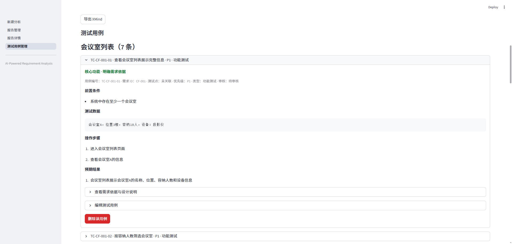

# TestForge AI

TestForge AI 是一个基于 AI 的需求分析与测试用例生成工具。上传产品需求文档（PRD），即可生成分析报告，并进一步生成、审核和导出测试用例。

## 界面预览





## 主要功能

- **需求分析**：提取产品概述、核心功能和业务规则，识别潜在风险、需求冲突、歧义、缺失及待确认问题，并展示原文依据与分析说明。
- **报告管理**：自动保存分析报告，支持历史查看、名称搜索、JSON 下载和原始 PRD Markdown 查看。
- **测试用例**：基于核心功能、业务规则和潜在风险生成用例，支持筛选、编辑、删除及历史版本查看。
- **用例导出**：支持 JSON 和 XMind 格式，便于后续整理与协作。

AI 分析结果与测试用例需要人工审核；推断出的风险不等同于已确认缺陷，缺少明确预期行为的风险用例会标记为待人工审核。

## 快速开始

需要 Python 环境，以及可访问的模型 API 或本地兼容服务。SQLite 随 Python 自带，无需单独安装数据库。

### 1. 获取项目并安装依赖

```bash
git clone https://github.com/Jennypopping/TestForgeAI.git
cd TestForgeAI
python -m venv .venv
```

激活虚拟环境并复制配置模板：

**Windows PowerShell**

```powershell
.\.venv\Scripts\Activate.ps1
Copy-Item .env.example .env
```

**Linux / macOS**（创建虚拟环境时可使用 `python3`）

```bash
source .venv/bin/activate
cp .env.example .env
```

```bash
python -m pip install -r requirements.txt
```

### 2. 配置模型

编辑 `.env`，填写自己的服务商、API Key、接口地址与模型名称。例如：

```dotenv
LLM_PROVIDER=deepseek
LLM_API_KEY=your_api_key
LLM_BASE_URL=https://api.deepseek.com
LLM_MODEL=deepseek-chat
LLM_TIMEOUT=120
```

| 服务商 | `LLM_PROVIDER` | `LLM_BASE_URL` |
| --- | --- | --- |
| DeepSeek | `deepseek` | `https://api.deepseek.com` |
| OpenAI | `openai` | `https://api.openai.com/v1` |
| 通义千问 | `qwen` | `https://dashscope.aliyuncs.com/compatible-mode/v1` |
| 自建网关或本地服务 | `custom` | 填写服务的 OpenAI 兼容根地址 |

`LLM_MODEL` 请填写服务商提供的模型 ID；切换服务商时同步修改 Key、地址和模型。接口地址不要附加 `/chat/completions`。本地服务不校验 Key 时，也需填写非空占位值（如 `local`）。

完整配置示例、参数兼容选项与旧版配置说明见 [`.env.example`](.env.example)。API Key 请保存在本地 `.env`，不要提交到版本库。

### 3. 启动应用

```bash
streamlit run app.py
```

浏览器访问 http://localhost:8501。

## 使用流程

1. 在「新建分析」上传 PRD（PDF、DOCX、Markdown 或 TXT），填写报告名称并开始分析。
2. 分析成功后，报告自动保存。可在「报告管理」搜索历史报告、查看分析结果和原文依据，或下载 JSON。
3. 从报告进入「测试用例管理」，生成测试用例，按模块、优先级、测试类型或来源筛选，并人工审核、编辑保存。
4. 导出 JSON 或 XMind；重新生成的用例集保存为新版本，可在历史列表中切换。

需求冲突、歧义、缺失及待确认问题保留在分析报告中，不直接参与用例生成。删除分析报告会同时删除关联的测试用例集。

## 数据与隐私

- 报告和测试用例保存在本机 SQLite 数据库，默认路径为 `data/testforge.db`，首次启动自动创建，后续启动保留历史数据。
- 可在 `.env` 中通过 `TESTFORGE_DB_PATH` 修改数据库路径；相对路径以项目根目录为基准。
- 备份历史数据时，请先停止应用，再复制数据库文件。删除数据库会丢失本地历史记录。
- 分析与用例生成会将相关需求内容发送至所配置的模型服务，请确认文档适合交由该服务处理；调用可能产生 API 费用。
